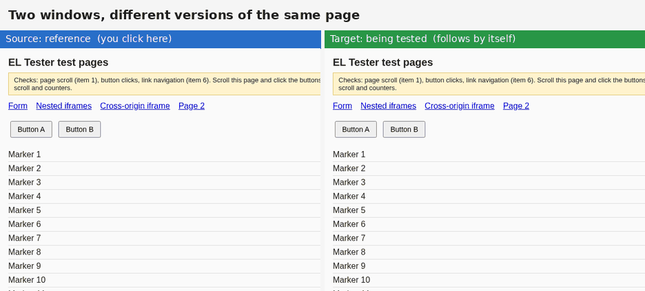
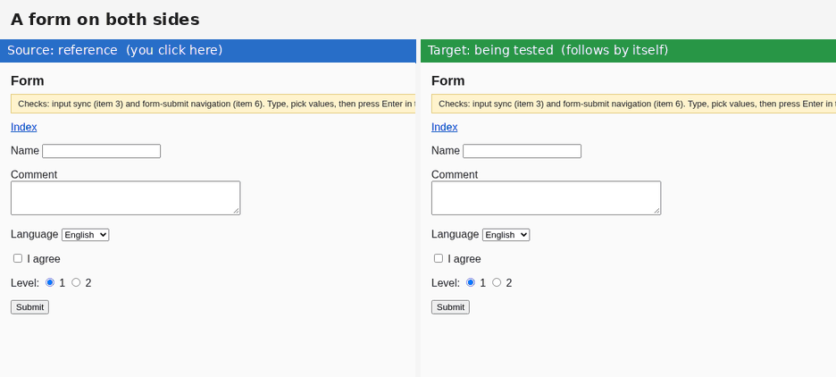
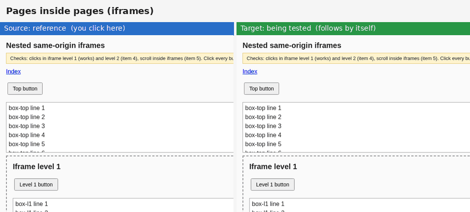
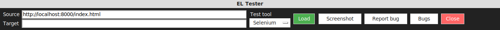

# EL Tester

**Test two versions of a website at once: click in one window, and the other window does the same.**

EL Tester opens two browser windows side by side, with two different versions of the same page:

- **Source** (left): the **reference** version, the one you know is right. You use it as usual.
- **Target** (right): the version **being tested**. Every click, scroll and typed letter on the Source is
  repeated here by itself.

So you only test once, and compare the two windows by eye.

It was made for e-learning courses: the original course as the Source and its translation as the Target.
It works with any two versions that have the same page structure, for example a page before and after a
change, or the live site and a new release on a test server.



---

## Why use it?

Checking a translated or updated website by hand means doing every step twice: click here, then click the
same thing in the other window, scroll both, type in both… It's slow, and it's easy to miss a difference.

EL Tester does the second half for you:

- 🖱️ **One set of actions, two windows.** You do each step once, and differences stand out at a glance.
- 🐞 **Bugs are reported on the spot.** One button saves a bug with screenshots of both windows.
- 🔎 **Missing parts are found for you.** If you click something that the Target doesn't have, the tool
  opens a bug report that's already filled in.
- ⚙️ **Two browser automation tools.** Run it with **Selenium** or with **Playwright**: pick one in a menu.

---

## What gets synchronized

| You do this on the Source                     | The Target does the same | Animation                                       |
| --------------------------------------------- | ------------------------ | ----------------------------------------------- |
| Click a button or a link                      | ✅                        | [clicks and scroll](docs/img/clicks_and_scroll.gif) |
| Scroll the page                               | ✅                        | [clicks and scroll](docs/img/clicks_and_scroll.gif) |
| Type text, pick from a list, tick a box       | ✅                        | [form](docs/img/form_inputs.gif)                |
| Click inside an iframe (a page inside a page) | ✅                        | [iframes](docs/img/nested_iframes.gif)          |
| Drag and drop (course matching exercises)     | ✅                        |                                                 |
| Play a video                                  | ❌ on purpose. A warning appears on the Target instead, so you start it yourself |  |

Links work in a smart way: each window opens **its own** link. If the Source is `site-en.com/page2` and
the Target is `site-pl.com/page2`, each window stays on its own site.

### Forms



### Pages inside pages (iframes)



---

## Reporting bugs

The toolbar stays on top of the browsers:



| Button         | What it does                                                                        |
| -------------- | ----------------------------------------------------------------------------------- |
| **Load**       | Opens the Source URL on the left and the Target URL on the right (empty = the same URL) |
| **Test tool**  | Selenium or Playwright (see below)                                                 |
| **Screenshot** | Saves a picture of both windows                                                    |
| **Report bug** | Opens a form: a short summary, severity, description. Saves it with screenshots of both windows |
| **Bugs**       | The list of saved bugs: filter, edit, delete, preview the screenshots, export to PDF |
| **Close**      | Closes both browsers and the app                                                   |

Bugs are saved in a small database file (`bug_data/bugs.db`) on your computer. **Save and create PDF**
makes a one-page PDF per bug, with both screenshots side by side, ready to send to someone.

### Missing elements are reported for you

If you click something on the Source and the Target doesn't have it, EL Tester waits 2 seconds (the page
may still be loading) and then opens a bug report that's already filled in:


---

## Selenium or Playwright?

Both are free tools that let a program control a browser. EL Tester can use either one. You choose in the
toolbar's **Test tool** menu, and you can switch at any time: the next **Load** closes the browsers and
opens new ones with the other tool.

|                                         | Selenium                         | Playwright                            |
| --------------------------------------- | -------------------------------- | ------------------------------------- |
| How it notices your actions             | Checks the page every 0.1 s      | The page tells it straight away       |
| Iframes from another website            | ❌ not synced                     | ✅ synced                              |
| Scrollable boxes inside the page        | Page scroll and iframes; not boxes on the main page | ✅ every scrollable box |
| Drag and drop, video warning            | ✅                                | not yet                               |
| Good to know                            | The best-known tool, used in many companies | Newer, faster, waits for pages by itself |

Not sure? Start with **Selenium** (the default). Try **Playwright** when a page has content from another
website (an embedded video player, a cookie banner, …).

---

## Install

You need:

1. **Python 3.10 or newer** with **tkinter** (the toolbar).
   On Windows and macOS it comes with Python. On Debian/Ubuntu: `sudo apt install python3-tk`.
2. **Google Chrome** or **Chromium**.
3. A **desktop** session. On Linux, use an X11 session (Wayland isn't supported).

Then, in a terminal:

```bash
git clone https://github.com/tawny0w1/el_Tester.git
cd el_Tester
python3 -m venv .venv
source .venv/bin/activate              # Windows: .venv\Scripts\activate
pip install -r requirements.txt
python -m playwright install chromium  # the browser Playwright uses
```

> Selenium downloads its browser driver (`chromedriver`) by itself the first time it runs.

---

## Try it in 1 minute with the test pages

The project comes with small test pages in `test_pages/`. They show a click counter on every button, so
you can see at once that both windows did the same thing.

**Terminal 1**: serve the test pages:

```bash
python3 -m http.server -d test_pages 8000
```

**Terminal 2**: start EL Tester:

```bash
python3 el_tester.py
```

In the toolbar:

1. **Source:** `http://localhost:8000/index.html`
2. **Target:** `http://127.0.0.1:8000/index.html` (the same files at a different address, like two
   versions of a site)
3. Click **Load**. The first load takes about 10 seconds.
4. Click the buttons and links, and scroll, in the **left** window, then watch the right one.

More pages to try:

| Page                | What to try                                                         |
| ------------------- | ------------------------------------------------------------------- |
| `form.html`         | Type, choose from the list, tick the boxes                          |
| `nested.html`       | Click buttons inside iframes, scroll the boxes                      |
| `cross_origin.html` | An iframe from another address: compare Selenium and Playwright     |
| `index2.html`       | Use as the **Target** with `index.html` as the Source, then click Button B: it's missing on the Target |

---

## How it works (short version)

1. A small JavaScript "tracker" runs in the **left** page and notes each click, scroll and input, with
   the element's position in the page (its [XPath](https://developer.mozilla.org/en-US/docs/Web/XML/XPath),
   for example `/html/body/p[2]/button[1]`).
2. Python receives the action. Selenium reads it every 0.1 s; Playwright gets it at once.
3. Python finds the element at the **same XPath** in the right window and does the same action there.

This is why both versions must have the **same page structure**. The text may differ (that's the point of
a translation), but the buttons must be in the same places.

| File                    | What's inside                                     |
| ----------------------- | ------------------------------------------------- |
| `el_tester.py`          | Starts the app; the Selenium version              |
| `pw_tester.py`          | The Playwright version                            |
| `engine.py`             | What both versions have in common                 |
| `floating_ui.py`        | The toolbar                                       |
| `report_form.py`, `bug_window.py` | The bug form and the bug list           |
| `reports/`              | Saving bugs, screenshots and PDFs                 |
| `js/`                   | The JavaScript trackers that run in the pages    |
| `test_pages/`           | Test pages                                        |
| `tests/`                | Automated checks for developers: see [tests/README_unit_tests.md](tests/README_unit_tests.md) |
