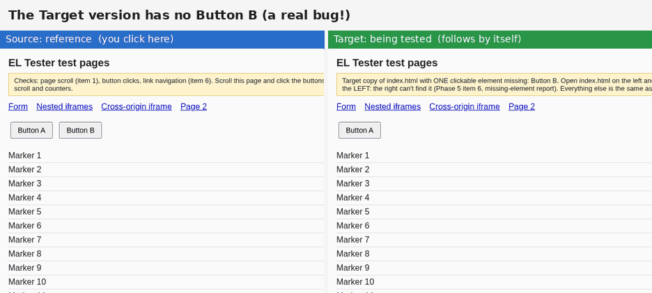

# EL Tester

A technical demonstration of **UI testing automation in the browser, using Python**: one program controls two browser windows,
records what the user does in the first one, and repeats the same actions in the second. The same task is
implemented twice, with **Selenium** and with **Playwright**, so the two libraries can be compared on the
same code.

The program opens two Chromium windows side by side:

- **Source** (left): the reference version of a page. The user works in this window.
- **Target** (right): a different version of the same page. The program repeats each click, scroll and typed
  value from the Source here.

The use case behind it is checking e-learning courses: the original course in
the Source and its translation in the Target. Was tested on Articulate Rise course in '360 preview' mode. The technique works for any two pages with the same HTML
structure (for example a page before and after a change), because elements are matched by their position
in the page, not by their text (see [How it works](#how-it-works)).


---

## The testing problem

After a course is translated, or a page is changed, someone has to check the new version in the browser:
does every button still work, does the text fit in its box, does each step look like the original? This
is manual UI testing. With two versions to compare, every step is done twice: click a button in the
original, then the same button in the new version, scroll both, type the same answer in both.

A typical automated UI test doesn't cover this case well. A test script (written with Selenium or
Playwright) clicks through the page and checks conditions that someone wrote in advance, for example
"after clicking Next, the heading is _Lesson 2_". It doesn't notice a translated label that is cut off or
covers an image, because nobody wrote a check for that. Also, a translation changes exactly the texts that
such checks usually compare.

This project combines the two approaches. The tester performs the steps by hand in the Source and judges
what they see. The program repeats the same steps on the Target, so both windows are always in the same
state and can be compared side by side. This is a kind of **record and replay**, except that each action is
replayed right away, not later from a saved script.

---

## What the project demonstrates

- **Automating UI tests in a real browser** with two libraries, Selenium and Playwright, behind one common
  interface (`Engine` in `engine.py`), so the rest of the program doesn't depend on which one is running.
- **Injecting JavaScript into a page** to observe the user: event listeners record clicks, inputs and
  scrolls.
- **Matching elements across two pages** by their XPath.
- **Two ways to move data from a page to Python**: _polling_ (Python asks every 0.1 s) and _push_ (the page
  calls Python).
- **A browser security rule in practice**: the same-origin policy, and how it limits what a page's
  JavaScript can see inside iframes.
- **Threads and queues**: a Tkinter toolbar and the browser threads exchange work through queues.
- **A small bug-tracking layer**: SQLite storage, screenshots and PDF export.

---

## How it works

1. A small JavaScript **tracker** runs in the **left** page. It listens for clicks, scrolls and inputs, and
   notes each one with the element's position in the page, its
   [XPath](https://developer.mozilla.org/en-US/docs/Web/XML/XPath), for example `/html/body/p[2]/button[1]`.
2. **Python receives the action.** With Selenium, Python reads it from the page every 0.1 s; with
   Playwright, the page sends it to Python at once.
3. **Python finds the element at the same XPath** in the right window and performs the same action there.

This is why both versions must have the **same page structure**. The text may differ (in a translation it
does), but the elements must be in the same places. If the Target has no element at that XPath, the action
can't be repeated, and the program reports it as a missing element (see
[Detecting missing elements](#detecting-missing-elements)).

---

## What gets synchronized

| Action on the Source                          | What the program does on the Target                                                                                                                                           | Animation                                           |
| --------------------------------------------- | ----------------------------------------------------------------------------------------------------------------------------------------------------------------------------- | --------------------------------------------------- |
| Click a button                                | Clicks the element at the same XPath                                                                                                                                          | [clicks and scroll](docs/img/clicks_and_scroll.gif) |
| Click a link                                  | Opens the `href` of the Target's **own** link at the same XPath. With `site-en.com/page2` on the left and `site-pl.com/page2` on the right, each window stays on its own site | [clicks and scroll](docs/img/clicks_and_scroll.gif) |
| Scroll the page                               | Sets the same scroll position (`scrollTop`)                                                                                                                                   | [clicks and scroll](docs/img/clicks_and_scroll.gif) |
| Type text, choose from a list                 | Sets the same value in the matching field, then fires the `input` and `change` events, so the page's own scripts react as if the user had typed                               | [form](docs/img/form_inputs.gif)                    |
| Tick a checkbox or a radio button             | Repeats it as a click on the matching box                                                                                                                                     | [form](docs/img/form_inputs.gif)                    |
| Click inside an iframe (a page inside a page) | Finds the same iframe on the Target (by the XPath of each iframe, from the outer to the inner one), then clicks inside it                                                     | [iframes](docs/img/nested_iframes.gif)              |
| Drag and drop (Rise matching exercises)       | Sends synthetic pointer events (`PointerEvent`) that move the same piece by the same distance                                                                                 |                                                     |
| Point at a video                              | Playback is **not** synchronized, by design. A warning appears on the Target instead, and the tester starts that video by hand                                                |                                                     |

### Forms


### Pages inside pages (iframes)


---

## Selenium and Playwright compared

Both libraries control a real browser from code. The toolbar's **Test tool** menu selects one; the next
**Load** closes the browsers and starts new ones with the other library (`run_app` in `el_tester.py`).

Both implementations follow the three steps from [How it works](#how-it-works): put a tracker into the
Source page, get the recorded actions to Python, and repeat them on the Target. The table shows how each
library does each part, and what difference that makes for the person testing.

| Topic                                                                                                  | Selenium (`el_tester.py`)                                                                                                                                                                                                                                                                                                                                                           | Playwright (`pw_tester.py`)                                                                                                                                                                                                                                                                                                              |
| ------------------------------------------------------------------------------------------------------ | ----------------------------------------------------------------------------------------------------------------------------------------------------------------------------------------------------------------------------------------------------------------------------------------------------------------------------------------------------------------------------------- | ---------------------------------------------------------------------------------------------------------------------------------------------------------------------------------------------------------------------------------------------------------------------------------------------------------------------------------------- |
| **Connection to the browser**                                                                          | Python sends each command as an HTTP request to **chromedriver**, a separate program that controls Chrome (the W3C WebDriver protocol). Common tasks have ready-made commands, for example `set_window_position(x, y)` to place the Target window.                                                                                                                                  | Python sends commands to Playwright's driver process, which talks to Chromium over the **Chrome DevTools Protocol** (CDP), the protocol Chrome's DevTools use. Some tasks have no high-level command: to place the Target window, the program sends the CDP message `Browser.setWindowBounds` itself (`_align_right_window`).            |
| **Putting the tracker into the page**                                                                  | `execute_script` runs the tracker once, in the page that is open at that moment. Following a link loads a new page without the tracker, so the program injects it again after each navigation (`synchronize_clicks`).                                                                                                                                                               | `add_init_script` registers the tracker once. The browser then runs it at the start of every page load and in every iframe, from any website. Nothing has to be injected again.                                                                                                                                                          |
| **Getting actions to Python**                                                                          | **Polling.** The tracker saves the last action in the page's `sessionStorage`, and Python loops read it every 0.1 s. There are six loops: scroll, clicks, typing, scroll in iframes, drag, video.<br>**Result:** the Target follows up to about 0.1 s later. The click key holds only the last click, so if two clicks happen between two reads, only the second one is repeated.   | **Push.** `expose_binding` adds a function `window.reportAction(...)` to the page; when the tracker calls it, Playwright runs the Python method `_on_action`.<br>**Result:** each action reaches Python as soon as it happens, in the order it happened.                                                                                 |
| **Iframes from another website** (for example a cookie banner served from a consent provider's domain) | The tracker runs in the main page and reaches into iframes through `iframe.contentDocument`, every 0.5 s. The browser's **same-origin policy** forbids a page's JavaScript from reading an iframe from another origin, so this access is blocked.<br>**Result:** clicks, typing and scrolling inside such an iframe happen only on the Source. The Target's iframe stays unchanged. | The tracker already runs **inside** each iframe (see the row above), so it doesn't need to reach in from outside. Python finds the matching iframe on the Target by the XPaths of the iframes around it (`_frame_xpaths`, `_right_frame`).<br>**Result:** actions inside iframes from other websites are repeated on the Target.         |
| **Scrolling**                                                                                          | The main page's scroll is copied from one element: the first scrollable element from a fixed list of CSS selectors (`#page-wrap`, `.page__content`, `.cover`), or the whole page if there is none. Inside iframes from the same website, any scrolled element is copied.<br>**Result:** scrolling a box in the main page (for example a `div` with `overflow: auto`) is not copied.                             | One `scroll` listener in every frame catches the scroll of any element and reports its XPath and `scrollTop`.<br>**Result:** every scrolled element is copied, in the main page and in iframes.                                                                                                                                          |
| **Waiting for the page**                                                                               | The program writes the waiting itself. `WebDriverWait(driver, 10)` waits up to 10 s for the course player (`iframe.player`); a page without one waits the full 10 s. `wait_and_run_on_right` looks for the Target element every 0.1 s, for up to 2 s.<br>**Result:** a page without a course player opens after about 10 s.                                                                     | Waiting is built into the library. `locator.evaluate(..., timeout=2000)` waits up to 2 s for the Target element. `wait_for_function` checks for the course player every 0.2 s and stops when it appears, or 5 s after the page has finished loading.<br>**Result:** a page without a course player opens about 5 s after it has loaded. |
| **Threads**                                                                                            | Each command is an independent HTTP request, so several threads can share one browser. Each of the six polling loops runs on its own thread.                                                                                                                                                                                                                                        | Playwright's sync API works only on the thread that started it. All browser work runs on one thread (`PwEngine`). Other threads, such as the toolbar's Screenshot button, send it functions through a queue and wait for the result on a `Future`.                                                                                       |
| **Running JavaScript on the Target**                                                                   | `execute_script("… arguments[0] …", value)` sends the body of a script. Values arrive as `arguments[0]`, `arguments[1]`, …, and the script returns its result with a top-level `return`.                                                                                                                                                                                            | `locator.evaluate("(el, a) => …", action)` sends a JavaScript function. Playwright first finds the element and passes it to the function as `el`.<br>**Result:** the drag and video replay scripts exist in two forms in `js/`: `drag_replay.js` for Selenium and `pw_drag_replay.js` for Playwright.                                    |
| **Drag and drop, video warning**                                                                       | Work in the main page only.                                                                                                                                                                                                                                                                                                                                                         | Work in the main page and inside iframes, because they use the same `_on_action` path as clicks.                                                                                                                                                                                                                                         |

### Example: one drag, two timings

When a piece is dropped in a Rise matching exercise, the browser also fires a **click** on that piece.
Rise ignores this click, but when it is repeated on the Target, the click on a matched piece **unmatches**
it.

- **Playwright** receives "drag" and then "click" immediately, in that order. Without a fix, the Target
  matched the piece and unmatched it 30 ms later. The program now recognizes a click on the piece that
  was just dragged and skips it (`_is_click_ending_drag`).
- **Selenium** didn't need this fix because of its timing: the click loop reads every 0.1 s, and the drag
  loop pauses 1 s after each drag, so the click usually reaches the Target **before** the drag.

This shows the trade-off between the two approaches from the table. Push is faster and keeps the order of
events, but it also repeats the browser's extra events exactly. Polling is slower, and its delays can hide
such details, by accident.

### When the difference matters

On a Rise course, both implementations give the same result. The differences show up on pages with
content from another website (a cookie banner, an embedded video player) or with scrollable boxes:
Playwright repeats those actions, Selenium doesn't. Selenium is the default because it is the more widely
used of the two.

---

## Toolbar and bug reports

The toolbar stays on top of the browsers:


| Button         | What it does                                                                                               |
| -------------- | ---------------------------------------------------------------------------------------------------------- |
| **Load**       | Opens the Source URL on the left and the Target URL on the right (empty = the same URL)                    |
| **Test tool**  | Selects Selenium or Playwright (see [Selenium and Playwright compared](#selenium-and-playwright-compared)) |
| **Screenshot** | Saves a picture of both windows                                                                            |
| **Report bug** | Opens a form: a short summary, severity, description. Saves it with screenshots of both windows            |
| **Bugs**       | The list of saved bugs: filter, edit, delete, preview the screenshots, export to PDF                       |
| **Close**      | Closes both browsers and the app                                                                           |

Bugs are stored in an SQLite database file (`bug_data/bugs.db`). **Save and create PDF** writes one PDF
page per bug, with both screenshots side by side.

### Detecting missing elements

When a click on the Source has no matching element on the Target (nothing at the same XPath), the program
keeps looking for 2 seconds, because the Target page may still be loading. After that it opens a bug
report with the element's name already filled in:



The browser threads can't open a Tk window themselves (Tkinter must be used from one thread), so they put
the element's name on a queue, and the toolbar checks that queue every 200 ms.

---

## Install

You need:

1. **Python 3.10 or newer** with **tkinter** (the toolbar).
   On Windows and macOS it comes with Python. On Debian/Ubuntu: `sudo apt install python3-tk`.
2. **Google Chrome** or **Chromium**.
3. A **desktop** session. On Linux, use an X11 session (Wayland isn't supported).

Then, in a terminal:

```bash
git clone https://github.com/tawny0w1/el_Tester.git
cd el_Tester
python3 -m venv .venv
source .venv/bin/activate              # Windows: .venv\Scripts\activate
pip install -r requirements.txt
python -m playwright install chromium  # the browser Playwright uses
```

> Selenium downloads its browser driver (`chromedriver`) by itself the first time it runs.

---

## Trying it on the test pages

The project includes small test pages in `test_pages/`. Each button shows a click counter, so it is easy
to check that both windows did the same thing.

**Terminal 1**: serve the test pages:

```bash
python3 -m http.server -d test_pages 8000
```

**Terminal 2**: start EL Tester:

```bash
python3 el_tester.py
```

In the toolbar:

1. **Source:** `http://localhost:8000/index.html`
2. **Target:** `http://127.0.0.1:8000/index.html` (the same files at a different address, which the
   browser treats as a different website)
3. Click **Load**. The first load takes about 10 seconds.
4. Click the buttons and links, and scroll, in the **left** window, then compare the right one.

Other pages:

| Page                | What it shows                                                                                                                                |
| ------------------- | -------------------------------------------------------------------------------------------------------------------------------------------- |
| `form.html`         | Text fields, a list, checkboxes and radio buttons                                                                                            |
| `nested.html`       | Buttons inside iframes, including an iframe inside an iframe, and scrolling inside each iframe                                               |
| `cross_origin.html` | An iframe from another address: Selenium can't repeat clicks inside it, Playwright can                                                       |
| `index2.html`       | `index.html` without Button B. Use it as the **Target** with `index.html` as the Source, then click Button B to see a missing-element report |

---

## Project files

| File                              | What's inside                                                                                 |
| --------------------------------- | --------------------------------------------------------------------------------------------- |
| `el_tester.py`                    | Starts the app; the Selenium implementation                                                   |
| `pw_tester.py`                    | The Playwright implementation                                                                 |
| `engine.py`                       | The interface and settings both implementations share                                         |
| `floating_ui.py`                  | The toolbar                                                                                   |
| `report_form.py`, `bug_window.py` | The bug form and the bug list                                                                 |
| `reports/`                        | Saving bugs, screenshots and PDFs                                                             |
| `js/`                             | The JavaScript trackers and replay scripts that run in the pages                              |
| `test_pages/`                     | Test pages                                                                                    |
| `tests/`                          | Automated checks for developers: see [tests/README_unit_tests.md](tests/README_unit_tests.md) |
